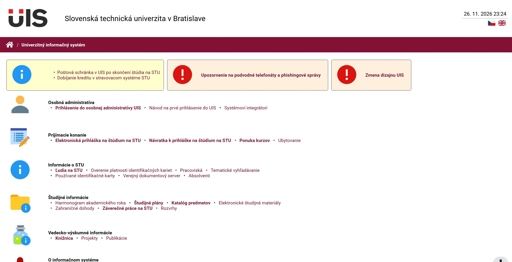
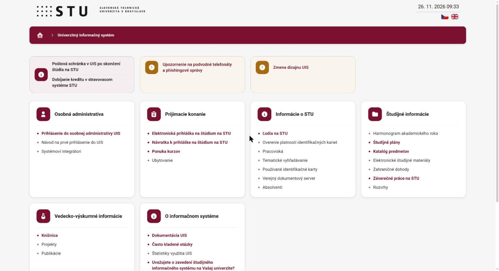
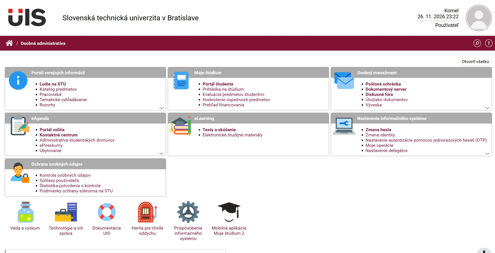
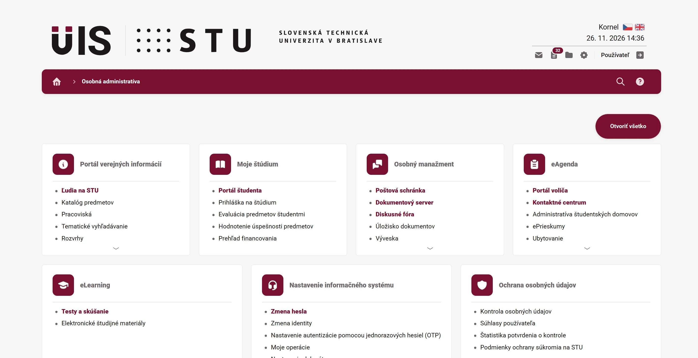
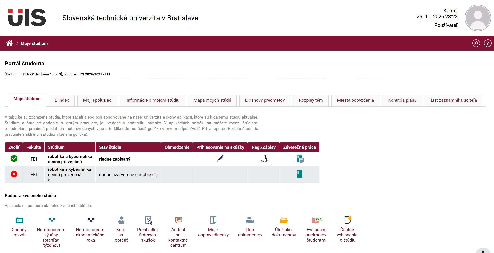
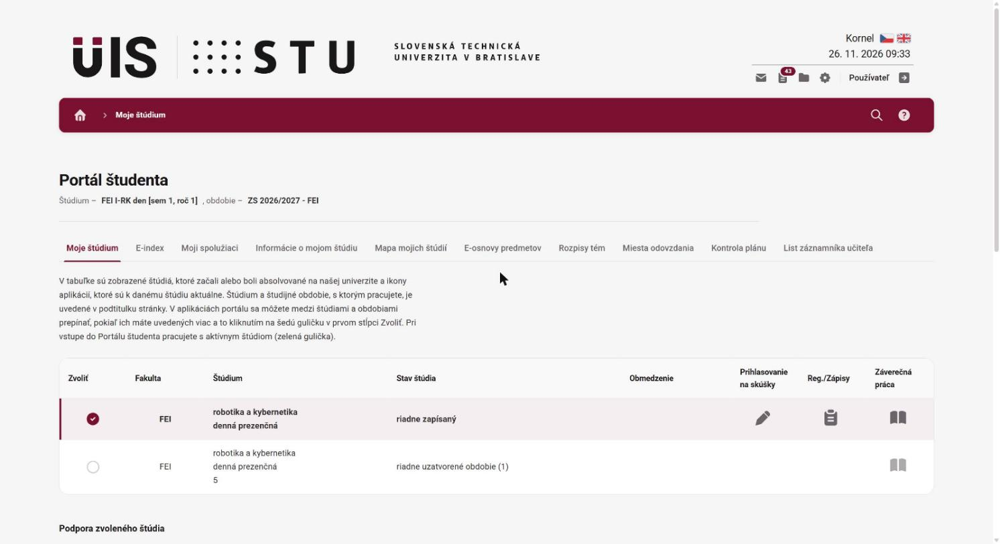
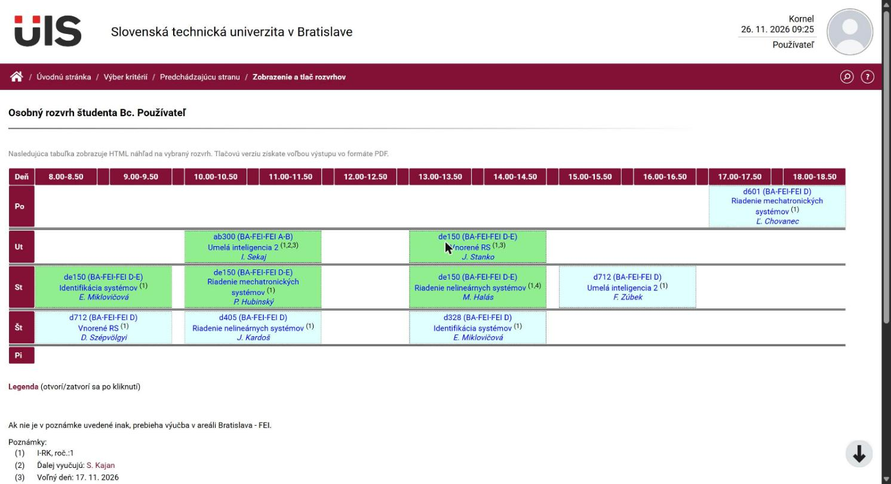
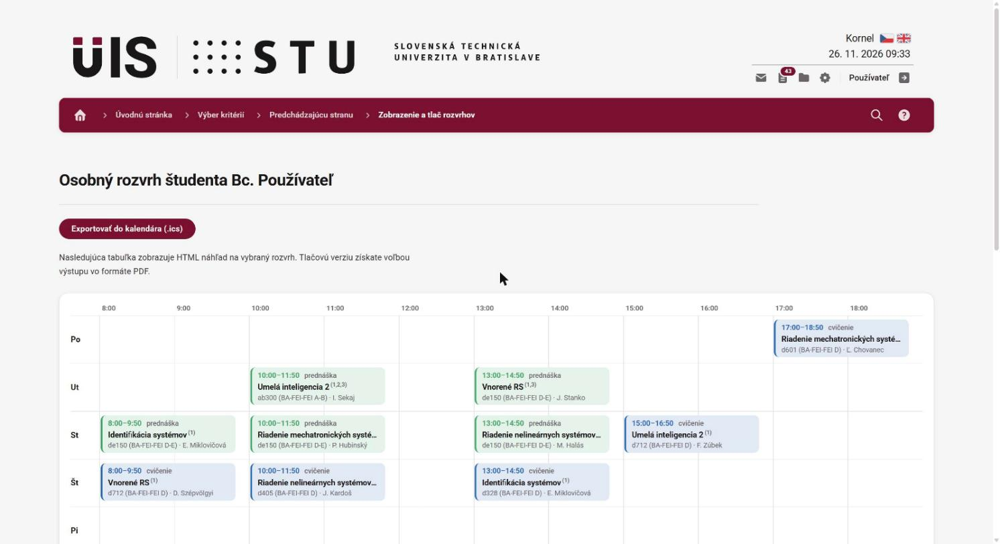
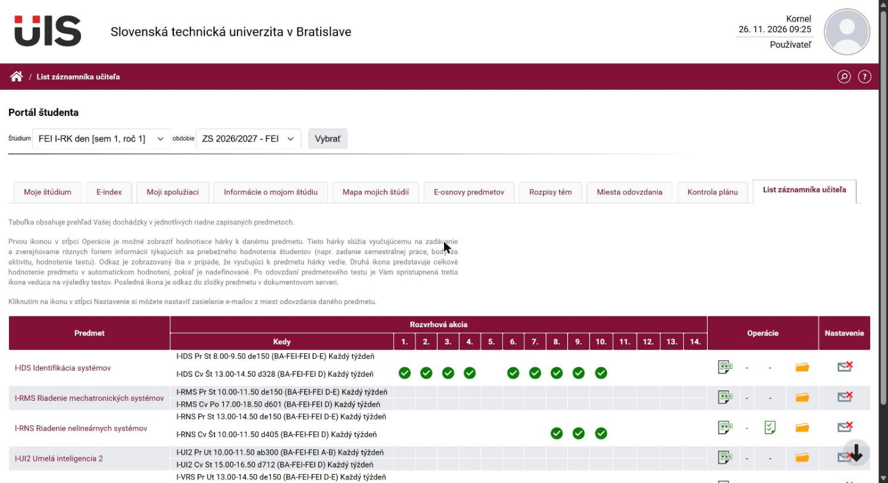
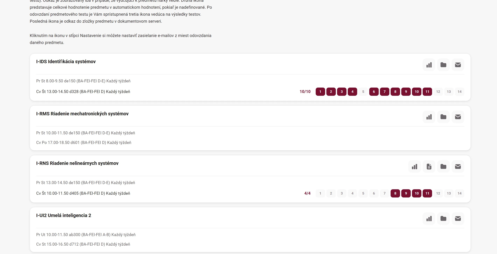

# BetterUis - STU UIS Visual Redesign

BetterUis is a browser extension that rebuilds the interface of the STU University Information System, UIS
([is.stuba.sk](https://is.stuba.sk)). The site's own layout dates from the mid-2000s: fixed-width banner
tables, hardcoded pixel widths, inline `font-size: 10px` cells and a maroon header graphic. This extension
replaces that with a flat, modern intranet design in light and dark themes, without breaking any of the
site's functionality.

> ## 🎉 BetterUis is live on the Chrome Web Store!
>
> No more developer mode, no more unpacked folders. BetterUis is now an official listing in the
> **[Chrome Web Store](https://chromewebstore.google.com/detail/lglhfnbkijbilfglhmmfinbommhcgcdc)**: one click
> in Chrome, Brave, Edge, Opera or Vivaldi, and it keeps itself up to date.
>
> **Firefox is next.** The Firefox Add-ons listing is in Mozilla's review right now and will appear
> [here](https://addons.mozilla.org/firefox/addon/betteruis/) as soon as it's approved. Until then, Firefox
> users can [install it from this repository](#manual-install-from-this-repository).
>
> Huge thanks to everyone who tested the early builds, reported broken pages and put up with the
> unpacked-extension dance. 💚

**Version 5.0.4** · Website: **[betteruis.greenybeany.dev](https://betteruis.greenybeany.dev)**

**[Install from the Chrome Web Store](https://chromewebstore.google.com/detail/lglhfnbkijbilfglhmmfinbommhcgcdc)** - Chrome, Brave, Edge, Opera and Vivaldi, with automatic updates.  
**Firefox Add-ons - coming soon** (in review); meanwhile [install manually](#manual-install-from-this-repository).

---

## Before & after

UIS as it ships (left) and with BetterUis (right), light theme, default accent. The name and photo in
the screenshots are placeholders.

### Public homepage

`is.stuba.sk` signed out: sections become cards, notices become tinted tiles.

| Before | After |
|---|---|
|  |  |

### Personal administration

The dashboard after signing in: the UIS | STU header with the user row, and card sections.

| Before | After |
|---|---|
|  |  |

### Portál študenta

Tabs, the study table with the chosen study marked, themed icons.

| Before | After |
|---|---|
|  |  |

### Timetable

The 131-column grid is redrawn as a week view with classes placed by time; a day-by-day agenda on phones.

| Before | After |
|---|---|
|  |  |

### List záznamníka učiteľa

Attendance as one card per subject with a 14-week strip instead of green ticks in a wide table.

| Before | After |
|---|---|
|  |  |

## Design direction

The visual language is "flat modern intranet": real 1px borders instead of shadows, tight corner radii,
generous whitespace, and restrained use of color. Roboto throughout, no monospace.

The single most important rule is how the accent color is used. Almost every piece of content on UIS is a
link, so coloring all links with the accent turns entire pages into a wall of one color. Instead, body links
use normal text color, and the accent is reserved for items the site itself marks as important (wrapped in
`<b>`), primary buttons, active tabs, and hover feedback.

STU's own heritage maroon (`#7a1030`) is the default accent, and light mode is the default theme.

---

## Features

### Themes and color
- Light and dark themes, with light as the default.
- Optional dark-mode schedule (default 22:00 → 06:00, windows that cross midnight work). While it's on, it
  decides dark vs light and the manual switch is locked. Open tabs flip on their own at the boundary. A
  preset theme still overrides it.
- Custom accent color, chosen from a curated palette in the popup.

### Language
The extension's own text (popup, timetable export button) is available in Slovak and English, picked in
the popup; "Auto" follows the browser language. Strings live in `i18n.js`. UIS's own pages stay in the
language set on the site.

### Timetable export
The personal timetable page (`rozvrhy_view.pl`) gets an **Exportovať do kalendára (.ics)** button
(`timetable.js`). It re-submits the page's own form in the "list of events / specific dates" mode, so every
occurrence comes with its real date (holidays and odd/even weeks included), and downloads `rozvrh.ics` for
Google, Apple or Outlook calendar. Event UIDs are stable, so re-importing updates rather than duplicates.
- The accent is stored raw as `--link-raw` and derived per theme into `--link`. In dark mode it is lightened
  slightly, because a dark saturated color used as text on a near-black surface has almost no contrast.
  Light mode uses the raw value unchanged.
- Preferences are saved in `chrome.storage.local` and mirrored to `localStorage`.

### Instant, flash-free load
The theme is read synchronously from `localStorage` and applied to `<html>` at `document_start`, before
`<body>` exists, so the original unstyled page is never visible. `chrome.storage.local` is treated as the
source of truth and reconciled immediately afterward.

### Unified icon set
The site ships several unrelated icon systems: an SVG sprite (`icons.svg`), a separate section sprite
(`menitka.svg`), and raster PNGs served from `img.pl`. `icons.js` replaces them with
[Tabler Icons](https://tabler.io/icons) (MIT), inlined as SVG so there are no external requests.

Replaced: breadcrumb icons, notice and alert icons, dashboard section icons, collapsed section icons, the
sign-out control, and the date and name-day icons.

Two categories are deliberately handled differently:

- **Sprites with an inline `--uc-fill-inner`** carry meaning through color - green for a passed subject, gold
  for a compulsory elective, navy for compulsory, red for a failure. These keep their original colors, since
  making them monochrome would discard information that is read at a glance in the grades table.
- **Sprites without it** are neutral interface glyphs (paginator arrows, refresh, tree chevrons). They had no
  theme-aware color at all and fell back to a fixed site default, so they follow the surrounding text color.

Language flags are redrawn as vectors. The originals are 17x11 pixel PNGs, far too small to enlarge without
blurring.

### Layout fixes
- Fixed-width centered content container, so the page no longer resizes when switching tabs. The original
  cause was the site's shrink-to-fit layout tables sizing the content column differently on every page.
- Data tables fill their container and size columns properly. The site's hardcoded `nowrap` attributes and
  inline header `white-space: nowrap` are overridden so columns distribute across the full width.
- Application pages (Portal studenta, e-index and similar) get styled tab strips, data tables with zebra
  striping and tabular numerals, application shortcut tiles, legends, and form controls. None of this was
  styled before.
- Detail tables that have no table header are matched structurally and styled as label/value blocks.
- The header logo is restored, sized from a single `--logo-h` token with width derived from the source
  image's 525x82 ratio so it cannot be clipped.

### Restored functionality
The site's own stylesheets are left enabled. They are not purely decorative: rules keyed to data attributes
control which two-factor fields are visible, and icon sizing is computed from CSS custom properties they
define. Disabling them breaks that logic, so every visual property is overridden explicitly instead.

One earlier regression is worth recording. Hiding `#titulek` sitewide, to remove a duplicated title on the
login page, also hid the page heading and the semester selector on the e-index page. It is now hidden only on
the login page.

---

## Installation

For Chromium browsers, install BetterUis from the [Chrome Web Store](https://chromewebstore.google.com/detail/lglhfnbkijbilfglhmmfinbommhcgcdc) - one click, and
it updates itself. Firefox gets its own Add-ons listing as soon as Mozilla's review finishes; until then you
install it from this repository.

| Browser | Works | How to install |
|---|---|---|
| Chrome, Brave, Edge, Opera, Vivaldi (desktop) | ✅ | [Chrome Web Store](https://chromewebstore.google.com/detail/lglhfnbkijbilfglhmmfinbommhcgcdc), updates automatically |
| Firefox (desktop and Android) | ✅ | Firefox Add-ons coming soon (in review); [manual install](#manual-install-from-this-repository) for now |
| Brave / Chrome on Android, Safari, iOS | ❌ | These browsers can't run extensions at all |

### Chrome, Brave, Edge, Opera, Vivaldi - Chrome Web Store

1. Open [BetterUis in the Chrome Web Store](https://chromewebstore.google.com/detail/lglhfnbkijbilfglhmmfinbommhcgcdc).
2. Click **Add to Chrome** (Brave, Opera and Vivaldi show the same button; Edge first asks to
   **Allow extensions from other stores**).
3. Click the puzzle-piece icon in the toolbar and pin **BetterUis**, so its settings are one click away.
4. Open [is.stuba.sk](https://is.stuba.sk) - done.

The browser keeps it up to date on its own.

### Firefox (desktop and Android) - Firefox Add-ons (coming soon)

The listing is in Mozilla's review. Once it's public:


1. Open [BetterUis on Firefox Add-ons](https://addons.mozilla.org/firefox/addon/betteruis/) (on Android: in Firefox, menu → Add-ons → search "BetterUis").
2. Click **Add to Firefox** and confirm.
3. Open [is.stuba.sk](https://is.stuba.sk) - done. Firefox keeps it up to date.

### Manual install from this repository

For running the newest code before it reaches the stores. Uninstall the store version first,
so the two copies don't both restyle the page.

### Step 1 - Download BetterUis

**Easiest:** on the [GitHub page](https://github.com/greenythebeany/BetterUis) click the green **Code** button →
**Download ZIP**, then unzip it somewhere you'll keep it (e.g. `Documents\BetterUis`). Don't delete or move that
folder afterwards - the browser loads BetterUis from it.

**With git** (makes updating a single command):
```bash
git clone https://github.com/greenythebeany/BetterUis.git
```

You should now have a folder with `manifest.json` directly inside it.

### Step 2a - Chrome, Brave, Edge, Opera, Vivaldi (manual)

1. Open the extensions page - type it into the address bar:
   - Chrome: `chrome://extensions`
   - Brave: `brave://extensions`
   - Edge: `edge://extensions`
2. Turn on **Developer mode** (switch in the top-right corner; in Edge it's on the left).
3. Click **Load unpacked** and select the BetterUis folder (the one containing `manifest.json`).
4. Click the puzzle-piece icon in the toolbar and pin **BetterUis**, so its settings are one click away.
5. Open [is.stuba.sk](https://is.stuba.sk) - done.

It stays installed across restarts. The browser may occasionally show a "developer mode extensions" warning
on startup - that's normal for anything not from the store; just close it.

### Step 2b - Firefox (desktop)

**Quick try (until Firefox restarts):**
1. Type `about:debugging#/runtime/this-firefox` into the address bar.
2. Click **Load Temporary Add-on…**.
3. Select `manifest.json` inside the BetterUis folder.

Firefox removes it when it closes, because it isn't signed by Mozilla.

**Permanently - autoload tool (Windows):** loads BetterUis automatically every time Firefox starts.
1. Open `tools\firefox-autoload\betterais.cfg` in Notepad and change the path on the
   `const BETTERAIS_DIR = ...` line to where *your* BetterUis folder is. Use double backslashes, e.g.
   `"C:\\Users\\you\\Documents\\BetterUis"`.
2. Close Firefox completely.
3. Double-click `tools\firefox-autoload\install.cmd` and allow the administrator prompt.
4. Start Firefox - BetterUis is loaded.

To remove it again, run `uninstall.cmd` from the same folder.

**Permanently - signed add-on:** Mozilla signs add-ons for free, including private ones that never appear
in their store. With an addons.mozilla.org account and API keys (Developer Hub → Manage API Keys):
```bash
npx web-ext sign --channel=unlisted --source-dir . --api-key YOUR_ISSUER --api-secret YOUR_SECRET
```
This produces a signed `.xpi` in `web-ext-artifacts/`; drag it into Firefox to install it for good.

### Step 2c - Firefox for Android

Firefox for Android can't load a folder by itself; you push BetterUis from a PC over a USB cable:

1. On the phone: enable **Developer options → USB debugging** in Android settings, and in Firefox
   **Settings → Remote debugging via USB**.
2. Connect the phone, accept the "Allow USB debugging?" prompt.
3. On the PC, in the BetterUis folder (needs [Node.js](https://nodejs.org) and
   [adb](https://developer.android.com/tools/releases/platform-tools)):
   ```bash
   npx web-ext run --target firefox-android --firefox-apk org.mozilla.firefox --android-device <device-id>
   ```
   (`adb devices` lists the device id.)

Like desktop, this lasts until Firefox restarts. A signed `.xpi` (see above) can instead be installed for
good: in Firefox go to **Settings → About Firefox**, tap the Firefox logo five times to unlock the debug
menu, then **Settings → Install extension from file**.

### Using it

- Click the **BetterUis** icon in the toolbar for settings: light/dark theme (with an optional dark-mode
  schedule), accent colour, preset themes, the **Default / Nothing** style, animations and language.
- Changes apply to open UIS tabs immediately.
- On the timetable page, **Export to calendar (.ics)** downloads your semester for Google, Apple or
  Outlook calendar.

### Updating

**Chrome Web Store / Firefox Add-ons:** nothing to do - the browser updates BetterUis automatically.

**Manual install:** BetterUis checks this repository's latest release for a newer version (at most every
6 hours). When one is out, the toolbar icon shows a small badge and the popup shows a banner with a button
that opens the latest release.

- **Downloaded ZIP:** download the new ZIP and replace the contents of your BetterUis folder (keep the
  folder where it is).
- **git:** `git pull` in the folder.

Then reload it: Chrome/Brave/Edge - click ⟳ on the BetterUis card in the extensions page; Firefox with the
autoload tool - restart Firefox; temporary Firefox install - **Reload** in `about:debugging`. Finally
refresh the UIS tab with `Ctrl+Shift+R`.

### Troubleshooting

- **Nothing changed on UIS** - make sure BetterUis is enabled on the extensions page, then reload it (⟳)
  and hard-refresh the page (`Ctrl+Shift+R`).
- **"Manifest file is missing"** - you selected the wrong folder; pick the one that directly contains
  `manifest.json` (unzipping often creates a folder inside a folder).
- **Firefox lost BetterUis after a restart** - expected for a temporary install; use the autoload tool or a
  signed `.xpi`.
- **The page looks broken after an update** - reload the extension; old and new files mixed in memory
  are the usual cause.

### Applying changes during development
CSS and content scripts are only re-read when the extension itself is reloaded. After editing any file:

1. Open `chrome://extensions/` and click the reload icon on the BetterUis card.
2. Hard-refresh the UIS tab with `Ctrl+Shift+R`.

Changing theme or accent color in the popup applies live and does not need either step.

---

## File structure

```plaintext
BetterUis/
├── manifest.json     Extension configuration (Manifest V3)
├── content.js        Applies theme and accent at document_start
├── icons.js          Replaces the site's icon systems with Tabler Icons
├── style.css         Sitewide redesign
├── login.css         Login page only (/auth/ and /system/login.pl)
├── popup.html        Popup interface
├── popup.js          Popup logic and messaging
└── icons/            Extension icons (16/32/48/128), cut out of icon.jpg with a transparent background
```

`login.css` is scoped to the login pages, which use the same markup at two different URLs.

---

## Notes and limitations

- Runs only on `is.stuba.sk`, as declared in `manifest.json`.
- Desktop only. The content container has a minimum width and there is no mobile layout.
- Slovak pages wrap the header row in `#ie1`, English pages use `#ie2`. Every header rule covers both,
  otherwise the English header loses its layout entirely.
- Brave Shields blocks the site's `cookiebar.min.js`, since its URL carries `tracking=1&thirdparty=1`. The
  resulting console error is unrelated to this extension and harmless.
- The site's `Feature-Policy` header warnings for `speaker` and `vr` also come from the server, not from here.

---

## Credits

Icons are [Tabler Icons](https://tabler.io/icons), MIT licensed.

---

## Credits and licenses

BetterUis is an independent, unofficial project and is not affiliated with or endorsed by STU. All
third-party material it uses (Tabler Icons, the Roboto, Doto and Space Mono fonts, and the preset theme palettes) is free and
openly licensed. Sources, licenses and full license texts are in
[THIRD_PARTY_NOTICES.md](THIRD_PARTY_NOTICES.md), and in the extension itself under **Credits & licenses**
at the bottom of the popup (`licenses.html`).
